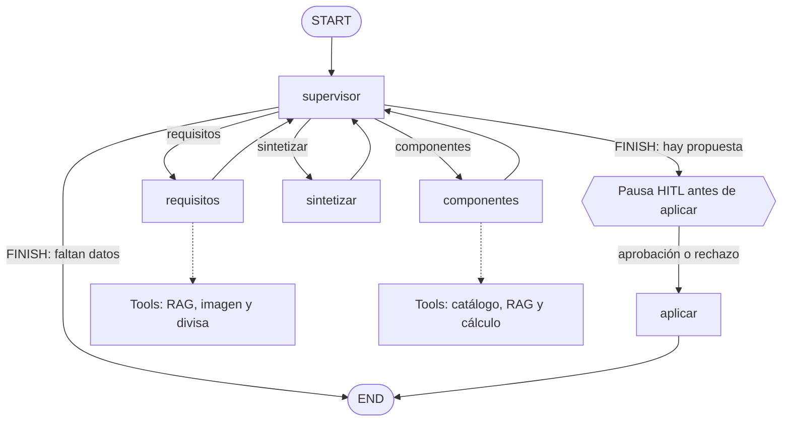

# PCompAgent: asistente de componentes de PC


**Estado:** en desarrollo · **Uso:** educativo

PCompAgent es un asesor conversacional para elegir componentes y preparar configuraciones de PC según el uso y el presupuesto. Combina un sistema RAG con un agente multiagente construido con LangGraph y una revisión humana antes de dar por cerrado un plan.

El proyecto reutiliza el RAG desarrollado en el **Project Break 1 (PB1)**: el agente del **Project Break 2 (PB2)** lo invoca como herramienta mediante `logic.responder()`, sin depender de Streamlit ni construir un segundo RAG.

## Índice

- [Alcance y contrato del agente](#alcance-y-contrato-del-agente)
- [Arquitectura](#arquitectura)
- [Grafo multiagente](#grafo-multiagente)
- [Herramientas](#herramientas)
- [Corpus y fuentes](#corpus-y-fuentes)
- [Instalación](#instalación)
- [Ejecución](#ejecución)
- [Ejemplos de uso](#ejemplos-de-uso)
- [Configuración](#configuración)
- [Estructura del proyecto](#estructura-del-proyecto)
- [Limitaciones y siguientes pasos](#limitaciones-y-siguientes-pasos)
- [Tecnologías](#tecnologías)
- [Equipo y licencia](#equipo-y-licencia)

## Alcance y contrato del agente

### Qué debe resolver

El asistente está diseñado para tratar peticiones relacionadas con PC por piezas, siempre que disponga de los datos necesarios:

| Tipo de petición | Ejemplo | Fuente o actuación prevista |
|---|---|---|
| Configuración por uso y presupuesto | «Quiero un PC gaming por 700 USD» | Extraer requisitos, consultar el catálogo y proponer un plan revisable. |
| Componentes individuales | «Tengo 150 USD para placa y RAM compatibles con AM4» | Buscar piezas del catálogo y razonar sobre la compatibilidad. |
| Características y compatibilidad | «¿Qué memoria usa una placa AM4?» | Consultar las fuentes disponibles y señalar la evidencia o la ausencia de datos. |
| Requisitos de videojuegos | «¿Qué requisitos recomendados tiene Cyberpunk 2077?» | Consultar el corpus de juegos cuando el título esté indexado. |
| Presupuesto en otra moneda | «Mi presupuesto es de 700 EUR» | Usar la herramienta de conversión; el catálogo usa USD. |
| Ficha técnica en imagen | «Lee la ficha y recomienda placa y RAM» | Interpretar una imagen admitida de `assets/` y usar los datos pertinentes. |

Para una recomendación, el agente comprueba los datos mínimos de uso y presupuesto según sus reglas. Si faltan, solicita una aclaración en vez de cerrar una propuesta. Las preguntas factuales también se pueden hacer directamente al RAG mediante `python main.py --ask`, sin pasar por el flujo de planificación.

### Qué no debe resolver

- Preguntas ajenas al dominio, por ejemplo «¿Cuál es la capital de Francia?». Debe explicar su ámbito y abstenerse.
- Datos que no estén respaldados por el catálogo, las guías, el índice disponible o las herramientas: no debe inventar productos, especificaciones, requisitos ni resultados de rendimiento.
- Precios actuales, existencias o enlaces de compra en tiempo real: los precios son una fotografía del dataset, expresada en USD.
- Compras, pagos o pedidos: el sistema propone y permite aprobar un plan, pero no ejecuta transacciones.
- Garantías de compatibilidad o rendimiento: la comprobación depende de la información disponible y del razonamiento del modelo; una persona debe verificar la propuesta antes de comprar.

Estas reglas expresan el **comportamiento esperado**, no una garantía de que el modelo siempre lo cumpla. En particular, el agente puede pedir datos adicionales incluso para una pregunta sencilla; las limitaciones conocidas se detallan [más abajo](#limitaciones-y-siguientes-pasos).

## Arquitectura

El sistema separa la preparación de datos de la conversación:

1. **RAG offline:** carga CSV y documentos, limpia y fragmenta el texto, genera embeddings y crea un índice vectorial persistente en ChromaDB.
2. **RAG online:** vectoriza la consulta, recupera los fragmentos más relevantes y pide a Gemini una respuesta anclada al contexto, con fuentes o abstención cuando no hay evidencia.
3. **Agente PB2:** un supervisor coordina especialistas y tools para producir una propuesta. La interfaz CLI y Streamlit son clientes del mismo grafo.
4. **Revisión humana:** el grafo se detiene antes de aplicar el plan; la persona lo aprueba o rechaza.

El corpus combina CSV de componentes y requisitos de videojuegos con guías de compra y montaje en Markdown. Cada fila de CSV se transforma en texto con metadatos; los documentos Markdown se dividen por secciones y fragmentos. Las guías descargadas en HTML se convirtieron a Markdown con `convertir_html_a_markdown.py` para conservar el contenido útil y reducir ruido y consumo de tokens.

## Grafo multiagente



Las líneas continuas representan los **edges del grafo**; las discontinuas indican herramientas que pueden usar los especialistas, no nodos independientes de LangGraph. Ambos especialistas reciben la allowlist completa: los grupos del diagrama describen sus usos habituales, no permisos exclusivos.

| Nodo | Responsabilidad |
|---|---|
| `supervisor` | Selecciona el siguiente rol o `FINISH`. Python valida la elección y dispone de reglas de respaldo si el LLM falla o propone una transición inválida. |
| `requisitos` | Detecta uso, presupuesto y necesidades; pregunta si faltan datos y elabora notas técnicas y un reparto orientativo. |
| `componentes` | Busca piezas concretas y razona sobre socket, memoria, formato y fuente según los datos disponibles. |
| `sintetizar` | Une las notas en una respuesta y un plan. Python extrae precios y avisa si el total calculado supera el presupuesto. |
| `aplicar` | Tras la decisión humana, cierra un plan aprobado o limpia la propuesta rechazada y conserva el motivo en el historial. |

El supervisor puede finalizar el turno sin pasar por HITL cuando faltan datos. En el caso normal con propuesta, LangGraph pausa **antes** de `aplicar` mediante `interrupt_before=["aplicar"]`; el cliente guarda la decisión con `update_state` y reanuda con `invoke(None)`. Una aprobación establece `done=True`; un rechazo permite pedir otra propuesta en el mismo hilo. La demo de la CLI puede aprobar automáticamente, mientras que los modos interactivos permiten decidir manualmente.

`MemorySaver` mantiene checkpoints en memoria identificados por `thread_id`. Se reutiliza el mismo identificador durante una conversación; uno nuevo inicia otra. Los hilos se pierden al reiniciar el proceso.

## Herramientas

El agente usa una lista permitida en `src/tools/__init__.py`: el modelo propone llamadas y Python valida argumentos y bloquea nombres no registrados. Cada llamada se registra con nombre, argumentos, estado (`ok`, `error` o `blocked`) y un resumen del resultado.

| Categoría | Tool | Función y uso habitual |
|---|---|---|
| RAG completo | `RAG_consultar_catalogo` | Invoca `logic.responder()` del PB1 para consultar catálogo, guías y juegos con fuentes; la usan los especialistas cuando necesitan evidencia. |
| Catálogo | `buscar_componentes` | Busca componentes en los CSV por categoría y rango de precio; la usa principalmente `componentes`. |
| API externa | `convertir_divisa` | Convierte moneda mediante [Frankfurter](https://frankfurter.dev/), con tasas locales de respaldo si falla la API; el resultado indica fuente y fecha. |
| Auxiliar | `calcular_total_build` | Suma precios y compara con un presupuesto; puede apoyar la revisión de la propuesta. |
| Auxiliar | `hora_actual` | Devuelve fecha y hora. |
| Multimodal | `describir_imagen` | Gemini interpreta una imagen permitida de `assets/`, como `assets/imagen_demo.jpg`. |

El respaldo de divisas es una fotografía local y puede estar desactualizado. La suma y la compatibilidad deben revisarse: extraer precios del texto o razonar con un LLM no equivale a una validación completa de la configuración.

## Corpus y fuentes

| Fuente | Formato | Contenido | Referencia |
|---|---|---|---|
| Catálogo de componentes de PCPartPicker | CSV | Doce categorías con precios y especificaciones. | Se utiliza el dataset incluido en `data/csv/`; falta verificar y documentar su URL de descarga original. |
| Requisitos de videojuegos | CSV | Requisitos mínimos y recomendados; el procesamiento filtra por año. | [Dataset en Kaggle](https://www.kaggle.com/datasets/baraazaid/pc-video-game-requirements-v2). |
| Guías de compra y montaje | Markdown | Guías sobre CPU, memoria, placa, fuente, SSD, refrigeración y montaje. | [Guía de montaje de Intel](https://www.intel.la/content/www/xl/es/gaming/resources/how-to-build-a-gaming-pc.html). |
| Imagen de demostración | JPEG | Ficha técnica de ejemplo creada para el proyecto. | `assets/imagen_demo.jpg`. |

Las fechas de descarga de los datasets y guías no constan en la documentación existente y deben añadirse cuando se confirmen. Las fuentes se usan con fines educativos; debe comprobarse la licencia y condiciones de cada fuente antes de redistribuir o reutilizar sus datos. No se deben incluir claves o secretos en el repositorio: `.env` está excluido por `.gitignore`.

El informe existente documenta que el índice suministrado puede estar **incompleto**: incluye CPU, placas, RAM, cajas y videojuegos, pero no todas las categorías ni las guías. El contenido efectivo depende del índice generado; disponer de un CSV o Markdown en `data/` no implica que esté indexado. `buscar_componentes` consulta los CSV para apoyar búsquedas de productos.

## Instalación

### Requisitos

- Python 3.10 o superior; el proyecto se ha desarrollado con Python 3.14.
- Git y conexión a internet para las dependencias y las llamadas a Gemini.
- Una clave de Gemini obtenida en [Google AI Studio](https://aistudio.google.com/apikey).
- Cuota disponible para los modelos de generación y, si se usan, embeddings de Gemini.

### Preparar el entorno

1. Clona el repositorio:

   ```bash
   git clone https://github.com/Ameisin/PCompAgent.git
   cd PCompAgent
   ```

2. Crea y activa un entorno virtual:

   ```powershell
   # Windows PowerShell
   python -m venv .venv
   .venv\Scripts\Activate.ps1
   ```

   ```bash
   # Linux / macOS
   python3 -m venv .venv
   source .venv/bin/activate
   ```

3. Instala las dependencias:

   ```bash
   python -m pip install -r requirements.txt
   ```

4. Copia `.env.example` a `.env` y añade tu clave:

   ```text
   GEMINI_API_KEY=tu_clave_aqui
   ```

   No compartas ni subas `.env`.

5. Prepara los embeddings y crea el índice. La generación puede tardar y consumir cuota:

   ```bash
   python main.py --prepare
   python main.py --index --recreate-index
   ```

   `--recreate-index` reconstruye la colección: úsalo cuando quieras reemplazar el índice existente. Repite la preparación y la indexación si cambias el modelo de embeddings, el corpus o los parámetros de fragmentación. Comprueba que las categorías esperadas se hayan indexado.

La opción `EMBEDDING_PROVIDER=huggingface` utiliza embeddings locales; requiere las dependencias correspondientes y recursos de descarga y disco. El agente y la generación con Gemini siguen necesitando clave.

## Ejecución

### RAG del PB1

| Comando | Resultado |
|---|---|
| `python main.py --prepare` | Carga, limpieza, fragmentación y embeddings en `output/embeddings.json`. |
| `python main.py --index --recreate-index` | Crea de nuevo la colección de ChromaDB con los embeddings preparados. |
| `python main.py --query "pregunta" --top-k 3` | Recupera fragmentos y contexto, sin generar la respuesta final. |
| `python main.py --ask "pregunta" --top-k 3` | Consulta el RAG completo y muestra respuesta y fuentes. |
| `python main.py --eval` | Evalúa retrieval con varios valores de K. |
| `python main.py` | Prepara e indexa si no hay índice y abre Streamlit. |

Ejemplos:

```bash
python main.py --ask "¿Qué socket usa el procesador AMD Ryzen 7 7700X?"
python main.py --ask "¿Cuál es la capital de Francia?"
```

La primera consulta depende de que el dato esté indexado; la segunda sirve para comprobar la abstención fuera del corpus.

### Agente multiagente

Desde la raíz del proyecto:

```bash
python -m src.verificar_grafo           # comprobaciones con LLM simulado, sin llamar a la API
python -m src.cli                       # demo con aprobación automática
python -m src.cli --sin-auto-aprobar    # demo que se detiene en HITL
python -m src.cli --interactivo         # chat con aprobación o rechazo manual
python -m src.cli --supervisor-reglas   # supervisor determinista, menos llamadas al LLM
streamlit run app.py                    # interfaz web
```

La CLI acepta, entre otras opciones, `--mensaje`, `--max-steps` y `--max-turns`. En modo interactivo, cuando haya un plan pendiente, escribe `aprobar` o `rechazar`; en el segundo caso puedes indicar un motivo. La demo estándar autoaprueba: utiliza `--sin-auto-aprobar` o `--interactivo` para revisar la pausa manualmente.

En Streamlit, el chat muestra el historial y la barra lateral permite ajustar límites, consultar el `thread_id` e iniciar una conversación nueva. Si hay un plan pendiente, aparecen los botones de aprobación y rechazo; el panel de depuración muestra el log del supervisor, las tools, checkpoints y estado HITL.

### Probar HITL y multimodal

1. Inicia el modo interactivo o Streamlit.
2. Pide: «Mira la ficha técnica de la imagen y dime qué placa base y RAM compatibles me recomiendas por menos de 150 USD».
3. Comprueba que la traza incluya `describir_imagen` y revisa el plan y sus precios.
4. Rechaza el plan con el motivo «como mucho 120 USD», pide «Ajústalo a ese límite» y revisa la nueva propuesta.
5. Aprueba la propuesta si procede; el estado pasa a `done=True`.

La imagen de ejemplo y los resultados de una prueba previa se describen en [`entregables/informe_decisiones.md`](entregables/informe_decisiones.md). El resultado de cada ejecución puede variar y debe comprobarse.

### API para clientes

CLI y Streamlit llaman al mismo contrato del agente:

```python
from src.agent import aprobar_plan, nuevo_thread_id, procesar_turno
from src.state import crear_estado

estado = crear_estado("")
thread_id = nuevo_thread_id()
estado = procesar_turno(
    estado, "PC para oficina con presupuesto de 400 USD",
    thread_id, max_steps=4, max_turns=6,
)

if estado["pendiente_hitl"]:
    estado = aprobar_plan(thread_id, True, estado)
    # Para rechazar: aprobar_plan(thread_id, False, estado, comentario="motivo")
```

El estado expone, entre otros campos, `respuesta`, `plan`, `resumen_presupuesto`, `pendiente_hitl`, `done`, `error`, `log`, `traza` y `thread_id`. `historial_checkpoints(thread_id)` permite consultar los checkpoints del hilo.

## Configuración

`config.py` concentra parámetros del RAG: rutas, categorías del corpus, filtros, tamaño y solapamiento de fragmentos, proveedor de embeddings y `TOP_K`. `src/config_grafo.py` reúne los parámetros del agente.

| Variable / parámetro | Valor por defecto | Propósito |
|---|---|---|
| `GEMINI_API_KEY` | Sin valor | Autenticación para Gemini; se configura en `.env`. |
| `EMBEDDING_PROVIDER` | `gemini` | Proveedor de embeddings; alternativa: `huggingface`. |
| `MAX_CHUNKS` | Sin límite global | Límite opcional de fragmentos al preparar el corpus. |
| `MAX_FILAS_POR_CSV` | `400` | Límite de filas por categoría. |
| `ESTRATEGIA_CHUNKING` | `markdown_headers` | Estrategia de fragmentación de documentos. |
| `AGENTE_GEMINI_MODEL` | `gemini-3.1-flash-lite` | Modelo de los nodos del agente. |
| `AGENTE_RAG_MODEL` | Modelo del agente | Modelo de generación utilizado por la tool RAG. |
| `AGENTE_LLM_RPM` / `AGENTE_RAG_RPM` | `10` / `4` | Límites de ritmo por modelo; ajustar a la cuota disponible. |
| `AGENTE_SUPERVISOR_LLM` | `1` | Con `0`, el supervisor utiliza reglas Python en lugar del LLM. |
| `MAX_ITER` | `8` | Límite de vueltas del supervisor por turno. |
| `max_steps` / `max_turns` | `4` / `6` | Límites de pasos con tools por especialista y mensajes por conversación. |

Los límites se controlan en Python y no los decide únicamente el modelo. La cuota y disponibilidad de los modelos pueden cambiar; consulta la documentación del proveedor si aparecen errores de API.

## Estructura del proyecto

```text
PCompAgent/
├── README.md
├── requirements.txt
├── .env.example
├── config.py                    # configuración del RAG
├── main.py                      # CLI del RAG e indexación
├── app.py                       # interfaz Streamlit del agente
├── load.py, clean.py, chunk.py # carga y preparación del corpus
├── embed.py, index.py           # embeddings e índice Chroma
├── retrieve.py, context.py      # recuperación y contexto
├── prompt.py, generate_rep.py   # prompt y generación
├── logic.py                     # API del RAG: responder(...)
├── eval_retrival.py             # evaluación de retrieval
├── gemini_auto.py, verificar.py
├── convertir_html_a_markdown.py
├── src/
│   ├── graph.py                 # estado, nodos, edges y HITL
│   ├── agent.py, state.py       # contrato y estado para clientes
│   ├── guardrails.py            # preferencias, aclaraciones y presupuesto
│   ├── config_grafo.py, llm.py  # configuración y modelo del agente
│   ├── registro_tools.py
│   ├── tools/                   # allowlist y herramientas
│   ├── cli.py                   # CLI del agente
│   ├── verificar_grafo.py       # comprobaciones con LLM simulado
│   └── README_GRAFO.md
├── tools/                       # utilidades y prototipos
├── data/                        # CSV, guías y respaldo de divisas
├── assets/                      # recursos visuales e imagen de demostración
├── queries/                     # preguntas de evaluación
├── entregables/                 # informe y documentación del proyecto
├── output/                      # embeddings y logs generados
└── chroma/                      # índice vectorial persistente
```

Los archivos de `output/` y `chroma/` son artefactos generados; su presencia en un checkout depende de cómo se haya distribuido el proyecto. No se deben asumir como completos o actualizados.

## Limitaciones y siguientes pasos

- **Índice incompleto:** regenerarlo y verificar la cobertura de categorías, juegos y guías antes de depender de él.
- **Compatibilidad no estructurada:** el LLM puede proponer combinaciones incompatibles. Añadir comprobaciones deterministas de socket, RAM, dimensiones, alimentación y demás restricciones; verificar manualmente mientras tanto.
- **Precio y disponibilidad:** los CSV no representan el mercado en tiempo real; confirmar precios y existencias en la tienda.
- **Presupuesto:** la extracción de precios del texto y el cálculo son orientativos; revisar manualmente total y moneda.
- **Memoria temporal:** `MemorySaver` no sobrevive al reinicio. Un checkpointer persistente como SQLite o PostgreSQL sería un siguiente paso.
- **Cuota y latencia:** un turno puede requerir varias llamadas al modelo y tardar minutos; errores de cuota o red pueden impedir la respuesta.
- **Detección de preferencias:** las reglas se basan en palabras clave; algunas formulaciones pueden necesitar aclaraciones.
- **Evaluación:** ampliar las pruebas de grounding, abstención, compatibilidad, HITL, multimodal y cobertura del índice; incorporar comprobaciones automáticas en CI.

La preparación del corpus, una configuración centralizada y la abstención ante datos ausentes son decisiones esenciales del proyecto. El paso de RAG a multiagente permite planificar recomendaciones, pero no elimina la necesidad de validar los datos ni sustituye la revisión humana.

## Tecnologías

| Área | Tecnologías |
|---|---|
| Lenguaje e interfaz | Python, Streamlit |
| Orquestación y herramientas | LangGraph, LangChain, `langchain-google-genai` |
| RAG y datos | ChromaDB, Google GenAI, pandas, LangChain text splitters |
| Embeddings locales | sentence-transformers / Hugging Face |
| Documentos | BeautifulSoup, pypdf |
| API externa | Frankfurter |
| Configuración y control de versiones | python-dotenv, Git y GitHub |

## Equipo y licencia

- Mario Bac Díaz — [Ameisin](https://github.com/Ameisin)
- Javier — [TermiJP](https://github.com/TermiJP)
- Jaime Pérez — [JaimePVillanueva](https://github.com/JaimePVillanueva)

Consulta [`LICENSE`](LICENSE) para la licencia del código y las condiciones de cada fuente para sus datos.
